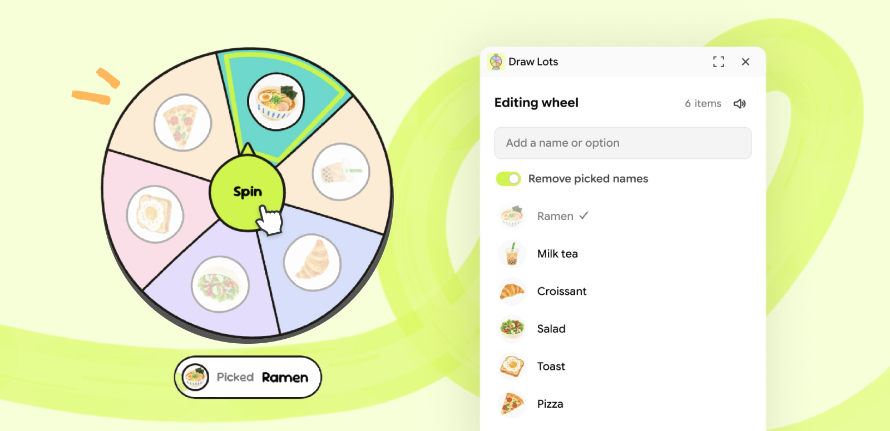

# Draw Lots

Spin a wheel on your board to pick a name, a team, or what's for lunch.

Open Draw Lots, type a name, and the wheel appears on your board. Add a few more, then click Spin.

## How to use

1. **Open it.** Click the Draw Lots icon in the right rail. The panel opens.
2. **Add names.** Type a name and press Enter, or paste a list with one name per line. The wheel appears on the board with your first name.
3. **Add images (optional).** Click the circle next to a name to add a photo. Images show on the wheel when it has 10 items or fewer.
4. **Spin.** Click Spin in the middle of the wheel. It lands on a random item and shows who was picked.

| Interaction | What happens |
| ------------------ | ------------------ |
| Click Spin | The wheel spins and lands on a random item. |
| Spin again with Remove picked names on | The last pick leaves the wheel and stays in the list with a check. |
| Click Reset on the wheel, or Reset picks in the panel | Everyone who was picked comes back. |
| Click a name in the panel | Rename it. Enter saves, Escape cancels. |
| Select another wheel | The panel switches to that wheel. |
| Duplicate a wheel | You get a separate wheel with its own list. |
| Click the speaker icon in the panel | Turns the spin sound on or off. |

Good to know:
- A wheel holds up to 20 items.
- The spin sound plays while the panel is open. Click inside the panel once to allow sound.
- Everyone on the board sees the result. Only the person who clicks Spin sees the wheel turn.
- Each spin adds a few steps to undo history, so undoing a spin can take more than one press.
- Thai names are supported.

---

## Credits

- [Sour Gummy](https://fonts.google.com/specimen/Sour+Gummy) and [Mitr](https://fonts.google.com/specimen/Mitr), both under the SIL Open Font License. License files are in `fonts/`.
